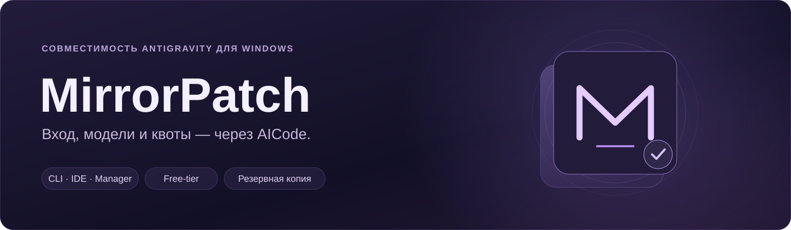

<p align="center">
  
</p>

<p align="center">
  <a href="https://github.com/Lotargo/mirror-patch/releases/latest"></a>
  
  
  <a href="LICENSE"></a>
  <a href="https://github.com/Lotargo/mirror-patch/releases"></a>
</p>

<p align="center">
  <strong>Вход, ответы моделей и загрузка квот в Antigravity.</strong><br />
  Совместимость с personal AICode и сохранение штатного маршрута для Pro.
</p>

<p align="center">
  <a href="https://github.com/Lotargo/mirror-patch/releases/latest/download/MirrorPatch-windows-x64.exe"><strong>Скачать EXE</strong></a>
  &nbsp; · &nbsp;
  <a href="https://github.com/Lotargo/mirror-patch/releases/latest/download/MirrorPatch-windows-x64.zip"><strong>ZIP с документацией</strong></a>
  &nbsp; · &nbsp;
  <a href="#поддерживаемые-версии">Совместимость</a>
  &nbsp; · &nbsp;
  <a href="docs/manual.md">Руководство</a>
  &nbsp; · &nbsp;
  <a href="#поддержать-проект">Поддержать</a>
</p>

---

MirrorPatch — поддерживаемая редакция патчера Antigravity. Исправляет устаревший путь авторизации и генерации, выбирает experience модели из серверной конфигурации и восстанавливает загрузку квот в CLI, IDE и Antigravity 2.0 / Manager.

> **Выпуск [1.6.0](https://github.com/Lotargo/mirror-patch/releases/tag/v1.6.0).** Штатная маршрутизация после отката для Pro, защита от повторного включения AICode, восстановление после автообновления Hub и раздельные окна квоты.

**Есть Google AI Pro и модели работают штатно?** AICode-совместимость устанавливать не нужно. Если ранее установленный launcher мешает Gemini 4, восстановите `manager` и/или `hub` при закрытом приложении. Версия 1.6.0 запомнит выбор штатного backend и не отменит его при автолечении. [Причина и порядок восстановления](docs/pro-native-routing-2026-11-24.md).

В **native patch v4** прямые SDK-вызовы выбирают Flash Lite и image-experiences из серверного каталога. STT и Voice/TTS используют отдельные production-маршруты; неизвестный model ID отклоняется без подстановки. Списки UI не расширяются. Результаты и ограничения Tab — в [отчёте SDK и Voice](docs/sdk-models-and-voice-patch-2026-11-15.md).

## Что исправляет MirrorPatch

| 🔑 Вход в IDE | 🧩 Выбор модели | 📊 Квоты и откат |
| --- | --- | --- |
| Personal-аккаунт получает фактическую лицензию через AICode `fetchLicenses`. | Experience выбирается из `fetchConfig` с учётом модели, без фиксированной привязки к Flash Low. | Квоты поступают через штатный AICode API. Исходные файлы сохраняются для восстановления. |

- **Отдельные профили.** Обычный `agy`, backend IDE и Manager обрабатываются независимо: изменение одного файла не выдаётся за исправление всех приложений.
- **Реальные серверные данные.** Подписка, доступные модели, остатки и сроки сброса определяются Google. Патч не создаёт лицензию и не увеличивает лимиты.
- **Проверка перед записью.** Исходная сборка определяется по SHA-256, для официального CLI дополнительно проверяется SHA-512. Обновление патча сохраняет первоначальный backup.
- **Нормальное завершение.** Windows Job Object завершает native-компонент вместе с launcher, устраняя оставшиеся backend-процессы после закрытия приложения.
- **Понятная диагностика.** Проверка файлов, состояния входа и доступности модели разделена. Локальный статус `patched` сам по себе не означает успешный запрос к сервису.

## Начать за минуту

1. Скачайте **[MirrorPatch-windows-x64.exe](https://github.com/Lotargo/mirror-patch/releases/latest/download/MirrorPatch-windows-x64.exe)** или **[ZIP](https://github.com/Lotargo/mirror-patch/releases/latest/download/MirrorPatch-windows-x64.zip)**. Установите официальное приложение Antigravity и запустите его хотя бы один раз, чтобы появился backend.
2. Сохраните работу и закройте Antigravity IDE, Antigravity 2.0 и терминалы с `agy`.
3. Запустите MirrorPatch. Выберите **13 — AICode access + quotas**, затем нужное приложение или все обнаруженные установки.
4. Откройте приложения заново. Проверьте короткий ответ модели и **Settings → Models & Usage**.

**Для готового EXE Python и Go не нужны.** Он содержит проверенные launchers. Если подходящего исходного CLI нет локально, патчер скачает официальную 1.5.9 с сервера Google и проверит точный размер и SHA-512. Это около 232 МБ; файлы Google не включены в релиз.

Для пользовательских установок в AppData права администратора обычно не нужны. Если приложение установлено в защищённую папку и запись запрещена, запустите MirrorPatch от имени администратора. При необходимости свежий OAuth-вход выполняется в браузере самим пользователем.

## Поддерживаемые версии

| Компонент | Версия | Профиль | Что проверено |
| --- | --- | --- | --- |
| Обычный CLI `agy` | **1.5.9**, Windows x64 | `cli` | Ответ модели и повторный запуск с сохранённой сессией |
| Backend IDE `agy --hub` | **1.5.9**, Windows x64 | `hub` | AICode-генерация и получение квот |
| Antigravity IDE | **2.7.0** | `ide` + `hub` | Вход, ответ модели и квоты в интерфейсе |
| Antigravity 2.0 / Manager | **2.32.1**, Windows x64 | `manager` | Ответ модели и квоты в интерфейсе |

Поддерживаются конкретные проверенные хеши, включая известные состояния прежних локальных патчей. Совпадения номера версии недостаточно. Сохранившиеся пункты старого меню относятся к legacy-патчам; для таблицы выше используйте **пункт 13**.

Новый AICode-путь не квалифицирован для Linux/macOS, enterprise, ADC, API-key и других версий приложений. Обновление Antigravity может заменить изменённые файлы. После него перепроверьте статус; неизвестную сборку не нужно принудительно патчить. Сетевой доступ к Google остаётся необходимым.

## Проверка и восстановление

```powershell
.\MirrorPatch-windows-x64.exe --version
.\MirrorPatch-windows-x64.exe --check --json
.\MirrorPatch-windows-x64.exe --hub-auth-status --json
```

В **пункте 13** есть отдельные операции проверки AICode и восстановления выбранного профиля. Рядом с native EXE сохраняются `*.before-aicode`, companion и manifest; у frontend — `main.js.before-aicode` и `main.js.aicode.json`. Старые `.agybak`/`.bak` сохраняются.

При закрытом приложении можно восстановить профиль командой:

```powershell
$hub = Join-Path $env:USERPROFILE '.gemini/bin/agy.exe'
.\MirrorPatch-windows-x64.exe --agy-aicode restore --profile hub --target "$hub"
```

Для полного отката IDE восстановите **оба** профиля: `ide` и `hub`. Перед ручным обновлением native CLI также выполните откат. [Полный порядок установки, диагностики и восстановления](docs/manual.md).

## Руководство и разработка

| Что нужно | Где читать |
| --- | --- |
| Установка, профили, CLI и откат | [Руководство](docs/manual.md) |
| Сборка EXE и выпуск | [Порядок релиза](releases/README.md) |
| Изменения версии 1.6.0 | [Changelog](CHANGELOG.md) |
| Google AI Pro, Gemini 4 и окна квоты | [Штатная маршрутизация](docs/pro-native-routing-2026-11-24.md) |
| Проверка GUI и причина зависания квот | [Отчёт](docs/gui-aicode-and-quota-patch-2026-11-15.md) |
| Прямой SDK, Flash Lite, image, STT, Voice/TTS и отказ Tab | [Patch v4](docs/sdk-models-and-voice-patch-2026-11-15.md) |
| Сборка и проверка выпуска 1.5.0 | [Отчёт выпуска](docs/release-1.5.0-2026-11-16.md) |
| Исследование рабочего free-tier пути | [AICode и бесплатный доступ](docs/aicode-free-access-working-path-2026-11-15.md) |
| Ошибка или предложение | [GitHub Issues](https://github.com/Lotargo/mirror-patch/issues) |

Из исходников нужны Python 3.11+ и Go 1.23+:

```powershell
python -m pip install packaging
python source/main.py
python -m unittest discover -s tests -v
Push-Location source/patcher/agy/aicode_runtime
go test ./...
go vet ./...
Pop-Location
```

Локальные тесты не требуют OAuth и не отправляют запросы к модели. Проверки с официальными бинарниками используют отдельные необязательные локальные fixtures. Реальные сетевые результаты и их ограничения приведены в отчётах.

## Поддержать проект

Если MirrorPatch оказался полезен и хочется отблагодарить за разработку, можно перевести любую удобную сумму в **ЮMoney**.

**Кошелёк:** `4100 1151 9523 9085`

<a href="https://yoomoney.ru/transfer"></a>

На странице перевода укажите номер кошелька выше. Поддержка добровольная. Спасибо за помощь, отзывы и сообщения об ошибках 💜

## Происхождение и лицензия

Исходный код MirrorPatch распространяется по **[GPL-3.0](LICENSE)**. Проект основан на snapshot Open AG Patcher 1.3.8; сведения об исходном проекте и других компонентах сохранены в [THIRD_PARTY_NOTICES.md](THIRD_PARTY_NOTICES.md).

MirrorPatch — независимый проект, не официальный продукт Google. Antigravity и сервис AICode принадлежат своим правообладателям; условия доступа и лимиты сервиса остаются за Google.
