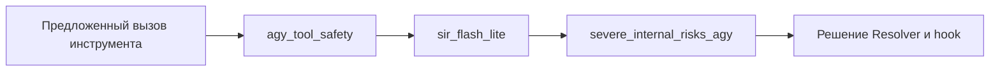

# Подсистемы безопасности native Antigravity

Дата: 2026-11-16. Исследован установленный Manager **2.32.1**, Windows x64.
Режим исследования — чтение бинарника, protobuf/debug metadata и read-only RPC.
Исполняемые файлы, патч, SDK, настройки и UI не изменялись.

Последующая [проверка runtime-контрактов](native-security-runtime-contracts-2026-11-16.md)
уточнила server flags, ограничения допуска embedded monitors и происхождение
SDK `content_rejected`. Ниже сохранены результаты исходного статического этапа.

## Результат

В движке действительно есть самостоятельная подсистема мониторинга действий
агента, отдельная от настройки фильтрации генерации:

```text
gdm/security/agi_control/agent_monitoring
third_party/jetski/cortex/policyguardian
```

Это встроенные Go-пакеты в `agy-aicode-native.exe`, а не обнаруженная отдельная
DLL. Наличие подсистемы и её связей с исполнением инструментов подтверждено
дизассемблированием. Активность всех её компонентов для текущего аккаунта и
конкретного диалога этим не устанавливается.

## Три разных слоя

| Слой | Конкретные находки | Что подтверждено |
| --- | --- | --- |
| Параметры генерации | `CompletionConfiguration.disable_safety_filtering` | Boolean-поле присутствует в embedded protobuf-схеме. Его влияние на текущий upstream не проверялось |
| Мониторинг действий | `agent_monitoring`, `NewJetskiMonitoringHooks`, `MonitorRunner`, `Resolver` | Отдельные проверки до/после инструмента и после model invocation |
| Проверка инструментов и политики | `PolicyGuardianMonitor`, `Guardian.Verify`, `policyguardian/vetting` | Реальная реализация проверки команд, файловых операций, зависимостей и потоков данных |

Не следует приравнивать эти слои к server-side moderation или к отказу самой
модели. Из наличия поля `disable_safety_filtering` не следует, что оно отключает
agent monitoring, PolicyGuardian либо серверные ограничения.

## Встроенная цепочка мониторов

Извлечена конфигурация, которую непосредственно читает
`externalMonitorConfigManager.Init`: **30900 байт prototext**.
Найдены три записи:

| Имя | Тип | Режим в embedded config | Фаза | Зависит от |
| --- | --- | --- | --- | --- |
| `agy_tool_safety` | `tool_safety_config`, проверка правил инструментов | `LOG` | `PRE_TOOL` | — |
| `sir_flash_lite` | `llm_config`, `MODEL_TIER_FLASH_LITE`, thinking `MINIMAL` | `LOG` | `PRE_TOOL` | `agy_tool_safety` |
| `severe_internal_risks_agy` | `llm_config`, `MODEL_TIER_FLASH`, thinking `LOW` | `BLOCK` | `PRE_TOOL` | `sir_flash_lite` |



Диаграмма показывает зависимости записей конфигурации, а не безусловный запуск
всех трёх проверок на каждом запросе. У каждой записи `enabled: true`, но также
**`experimental_only: true`**. Итог зависит от условий исполнения, экспериментов,
тегов и конфигурации. Одна лишь запись `BLOCK` не доказывает блокирование
проверенного SDK-диалога.

Схема поддерживает режимы `BLOCK`, `LOG`, `SOFT_BLOCK_INJECT`, `ASK`, `FORCE_ASK`.
Это значения протокола; они не были переключены или испытаны в этом исследовании.

LLM-проверки имеют собственные встроенные инструкции. По их содержанию это
проверка рискованных действий — в том числе credential access, destructive
actions, exfiltration, sabotage и data loss. Это отличается от обычного набора
категорий фильтрации текста. Полные инструкции и пороги в отчёт не копировались.

`MODEL_TIER_FLASH` и `MODEL_TIER_FLASH_LITE` — уровни выбора модели, а не
подтверждённые имена конкретных deployed weights или отдельных локальных моделей.
Фактические inference endpoints/вызовы этих проверок в этом этапе не захватывались.

## Связи с исполнением

Верифицированы прямые `call` инструкции, включая:

```text
core/pretoolhooks.newCommandAssessorHooks
  → NewJetskiCommandAssessorFromConfig
  → newJetskiCommandAssessorFromMonitorsConfig
  → NewJetskiMonitoringHooks
  → NewMonitoringPreToolHook / NewMonitoringPostToolHook

pre-tool / post-tool hook
  → MonitorRunner.Run
  → Resolver.Resolve
  → preToolInterventionToResult / handlePostToolIntervention

core/posthooks.NewCommandAssessorPostInvocationHook
  → NewPostInvocationEvaluatorFromConfig
```

Аналогичные связи найдены в executor-level pre-tool/post-tool hooks. Поэтому
подсистема не является просто неиспользуемым набором protobuf-типов.

Релевантные встроенные пути исходников из Go debug metadata:

- `gdm/security/agi_control/agent_monitoring/jetski/monitoring.go`
- `gdm/security/agi_control/agent_monitoring/jetski/monitoring_pre_tool.go`
- `gdm/security/agi_control/agent_monitoring/jetski/monitoring_post_tool.go`
- `gdm/security/agi_control/agent_monitoring/jetski/monitoring_post_invocation.go`
- `gdm/security/agi_control/agent_monitoring/monitors/go/runner.go`
- `gdm/security/agi_control/agent_monitoring/monitors/go/resolver.go`

Это исходные имена, встроенные в бинарник; наличие соответствующих `.go` файлов
в локальном checkout не заявляется.

## PolicyGuardian

Точное найденное имя адаптера — **`PolicyGuardianMonitor`**.
Его `Evaluate` вызывает:

```text
GetOrCreateGuardianWithDeps
Guardian.Observe
ScanTrajectory
Guardian.Verify
```

`Guardian.Verify` содержит вызовы deterministic vetting, проверки обратимости,
обработки контекста, выбора security profiles и цикла vetting. В пакете есть
`vet_destruction.go`, `vet_data_flow.go`, `script_execution.go`, `depsdev.go`,
`safebrowsing.go`, `vet_content.go`. В частности, `vetContentInternal` связан
с `IsRiskyModification` и анализом исполняемого кода; название «content» само по
себе не означает модерацию произвольного текста беседы.

Полезные точки навигации по встроенной debug metadata:

- `gdm/security/agi_control/agent_monitoring/jetski/policy_guardian_monitor.go:300`
  — `PolicyGuardianMonitor.Evaluate`.
- `third_party/jetski/cortex/policyguardian/guardian.go:534`
  — `Guardian.Verify`.
- `third_party/jetski/cortex/policyguardian/manager.go:74`
  — `GetOrCreateGuardianWithDeps`.
- `third_party/jetski/cortex/policyguardian/native_hooks.go:25`
  — `NewNativePreToolHook`.

Создатель PolicyGuardian регистрируется в monitor factory. При этом среди трёх
извлечённых embedded monitor-записей **нет `policy_guardian_config`**.
Он может использоваться отдельными native hooks или другой конфигурацией;
его включение в конкретной сессии остаётся UNKNOWN.

## Конфигурация и ограничения external build

Найдена загрузка embedded config и объединение с Mendel-конфигурацией:
`getMonitorsConfig → getMendelConfig`, затем `ParseConfig`,
`MergeMonitorsConfig`, `ValidateConfig`. Также есть отдельный server-mode path.
Поэтому встроенная таблица не гарантирует окончательную runtime-конфигурацию.

Часть скомпилированных вариантов — явные заглушки external build:

- `createAapMonitorFromConfig` возвращает ошибку неподдерживаемого AAP monitor.
- Аналогичные ошибки есть у AGCIS и AGCIS reasoning.
- `resolveModelAPIFallback` у PolicyGuardian сообщает, что backend fallback
  недоступен в текущей сборке. Это не доказывает неработоспособность других путей
  создания PolicyGuardian.

Следовательно, присутствие имени в схеме или таблице функций не доказывает
наличие доступного рабочего сервиса.

## Read-only runtime-проверка

В собственном изолированном native-процессе через SDK прочитаны metadata RPC:

| RPC | Результат |
| --- | --- |
| `GetAvailableModels` | Успех; monitor/guardian overrides не обнаружены в отобранных полях |
| `GetStaticExperimentStatus` | Успех; соответствующих полей не обнаружено |
| `GetServerConfiguration` | Успех; соответствующих полей не обнаружено |
| `GetUserSettings` | `provider_error`; настройки не получены |
| `GetPermissionSettings` | `provider_error`; настройки не получены |

Не вызывались `Set`/`Update` RPC, генерация, инструменты, опасные команды или
провокационные запросы. Отсутствие override в ответах не является доказательством
отсутствия runtime-мониторинга. Идентификаторы аккаунта, ключи, токены и полные
пользовательские настройки не экспортировались. Собственный процесс завершён.

## Доказательства и границы

Исследованный native SHA-256:

```text
b3fec35b68d5599ae0c0421304dee1e42de7cb1615bbe152a85e6383abecd9da
```

Функции и source metadata прочитаны из ранее извлечённой таблицы Manager;
инструкции — из текущего установленного native. Для выбранных функций проверено
совпадение байт с Manager backup. E8-кандидаты прямых вызовов дополнительно
проверялись дизассемблированием содержащей их функции. Protobuf-структуры
извлечены из текущего бинарника, embedded prototext найден по фактическому
аргументу вызова `ParseConfig` в `externalMonitorConfigManager.Init`.

Локальные ignored evidence и read-only скрипты:
`test_cache/safety-audit-2026-11-16/`:

- `security-symbols.json` — индекс относящихся к теме символов.
- `security-callgraph.json`, `security-callers.json` — инструкции и связи.
- `security-schema.json` — отобранные embedded protobuf definitions.
- `embedded-monitor-summary.json` — метаданные трёх мониторов без полных prompts.
- `runtime-security-metadata.json` — отобранные результаты read-only RPC.
- `index_security.py`, `analyze_security.py`, `descriptor_security.py`,
  `embedded_config.py`, `probe_security_config.py` — способы воспроизведения.

Продуктовый код не менялся; регрессионные тесты патча не запускались, поскольку
изменения исполняемого поведения отсутствуют. Выводы относятся к исследованному
Manager 2.32.1, а не автоматически ко всем версиям IDE/CLI/Hub.

Для сопоставления с публичным поведением: официальная
[документация Agent settings](https://antigravity.google/docs/agent-settings)
описывает отдельную оценку безопасности действий в Auto mode и permission
policies. Она не называет внутренние найденные пакеты: их идентификация основана
на локальном бинарнике, а не на предположении по документации.
